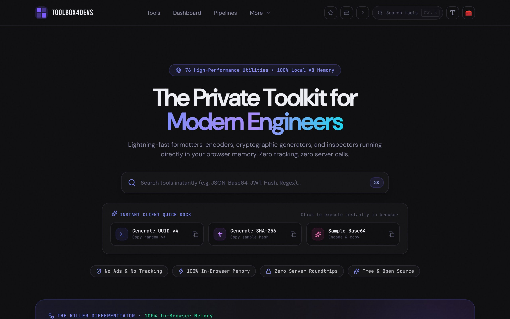
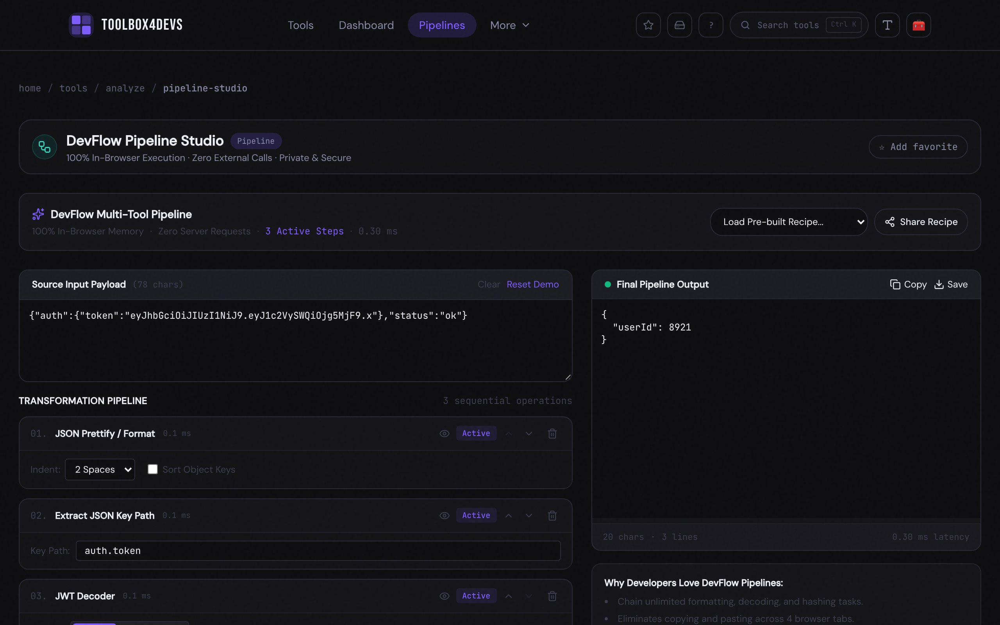

# ToolBox4Devs

<div align="center">
  <br />
  
  <h3>The Premier Fast, Private, 100% Client-Side Developer Utility Suite</h3>
  <p>94 essential developer utilities running entirely in your browser memory. Zero ads, zero tracking, zero server latency.</p>

  <p>
    <a href="https://www.toolbox4devs.com">
      
    </a>
    <a href="https://goldi0002.github.io/devtoolbox/">
      
    </a>
    <a href="https://github.com/goldi0002/devtoolbox/actions/workflows/ci.yml">
      
    </a>
    <a href="LICENSE">
      
    </a>
  </p>

  <a href="https://www.toolbox4devs.com">
    
  </a>
</div>

---

## 🔗 Pipeline Studio: chain tools without leaving the tab

Paste a payload once and run it through a sequence of steps, for example format JSON → extract a key → decode the JWT inside it. Everything executes in browser memory, and a pipeline can be shared as a link.

<div align="center">
  <a href="https://www.toolbox4devs.com/pipeline-studio">
    
  </a>
</div>

---

## 🌐 Hosted Website & Documentation

- 🌐 **Official Website:** [https://www.toolbox4devs.com](https://www.toolbox4devs.com)
- 📖 **Technical Documentation:** [https://goldi0002.github.io/devtoolbox/](https://goldi0002.github.io/devtoolbox/)
- 💻 **Source Code Repository:** [https://github.com/goldi0002/devtoolbox](https://github.com/goldi0002/devtoolbox)

---

## ⚡ Core Philosophy & Architecture

ToolBox4Devs was built to solve the frustration of using ad-ridden, slow, and privacy-invasive web utility sites for day-to-day software development tasks.

1. **🔒 100% Client-Side Processing**: Every single transformation, calculation, formatting pass, and cryptographic operation executes exclusively in browser memory. No data is ever transmitted to a backend.
2. **🛡️ Absolute Privacy Guarantee**: Safe for sensitive tokens, passwords, production database dumps, and private certificates.
3. **⚡ Static Site Generation (SSG)**: Built with `vite-react-ssg`, pre-rendering all 94 tool pages into static HTML for instant first-contentful paint and top-tier SEO rankings.
4. **📴 Offline & Progressive Web App (PWA)**: Includes a full Service Worker cache so you can install and use the entire utility suite while disconnected on planes, trains, or offline field environments.
5. **🔗 Compressed Stateless Sharing**: Uses `lz-string` URL hash compression (`#data=...`) to generate shareable links containing complete tool states without any server database storage.
6. **🎨 10 Tailored Developer Themes**: Switch effortlessly between Dark, Nord, Dracula, Monokai, Terminal, Sepia, Rose, Solarized, and custom high-contrast palettes.
7. **⌨️ Productivity-First UX**: Fast Command Palette (`Cmd + K` or `Ctrl + K`), customizable Quick Favorites drawer, and instant clipboard copying.

---

## 🛠️ Complete Tool Catalog (94 Tools)

### 1. 🗄️ Data & DevOps (21 Tools)
- **Delimited File Data Validator (`/csv-validator`)**: Validate CSV, TSV, and delimited TXT files with an interactive visual rule builder, regex constraints, type checks, and row-level error auditing.
- **CSV / TXT Large File Viewer (`/csv-txt-viewer`)**: Blazing-fast virtualized tabular spreadsheet viewer with search and column sorting.
- **Pipeline Studio (`/pipeline-studio`)**: Visual multi-step developer flow canvas to chain transformations (e.g. cURL → JSON → Schema).
- **CIDR & Subnet Calculator (`/cidr-calculator`)**: IPv4 CIDR prefix breakdown, usable IP ranges, wildcard masks, and binary bit visualizer.
- **Dockerfile Generator (`/dockerfile-generator`)**: Interactive template builder for Node, Python, Go, Rust, Java, and PHP containers.
- **Docker Run to Compose (`/docker-run-to-compose`)**: Convert complex `docker run` CLI invocations into clean `docker-compose.yml` files.
- **Cron Expression Parser (`/cron-parser`)**: Decode cron syntax into human speech, schedule breakdown, and upcoming execution timeline.
- **Cron Expression Generator (`/cron-generator`)**: Visual cron scheduler with preset frequencies and day/month pickers.
- **SQL Formatter (`/sql-formatter`)**: Beautify and indent SQL queries with customizable keyword casing and spacing.
- **JSON to SQL Converter (`/json-to-sql`)**: Generate `CREATE TABLE` DDL and `INSERT INTO` statements from raw JSON objects.
- **JSON to CSV / CSV to JSON (`/json-to-csv`)**: Two-way structured table and JSON conversion with nested object flattening.
- **YAML to JSON / JSON to YAML (`/yaml-json-converter`)**: Bi-directional parser with validation and format preservation.
- **TOML / JSON / YAML Converter (`/toml-json-yaml-converter`)**: Convert between TOML, JSON and YAML in any direction, with line-and-column syntax errors and a download with the right file extension.
- **SemVer Calculator (`/semver-calculator`)**: Compare semantic versions, test NPM caret/tilde ranges, and bump increments.
- **Unix Permissions Calculator (`/unix-permissions-calculator`)**: Interactive chmod calculator with octal, symbolic (`rwxr-xr-x`), and CLI flag breakdown.
- **Number Base Converter (`/base-converter`)**: Simultaneous real-time conversion between Binary, Octal, Decimal, and Hexadecimal.
- **Number to Words Converter (`/number-to-words`)**: Financial, cheque, and verbal numeral spellings in multiple numbering systems.
- **Timestamp / Epoch Converter (`/timestamp-converter`)**: Convert milliseconds, seconds, ISO-8601, and human dates across timezones.
- **ASCII Table Reference (`/ascii-table`)**: Complete 7-bit ASCII and extended reference with character search and control codes.
- **Age & Lifetime Milestone Calculator (`/age-calculator`)**: Precise chronological age, heartbeat/breath estimates, and planetary ages.
- **Time Zone Converter & Meeting Planner (`/time-zone-converter`)**: Convert a date and time across time zones with DST-aware offsets, a 24-hour planner that highlights working hours, zone search, and a copyable summary line.

### 2. 📋 JSON Utilities (5 Tools)
- **JSON Formatter & Validator (`/json-formatter`)**: Beautify, minify, repair syntax errors, and query with JSONPath. Includes Tree Explorer, Table Grid, and Schema & Stats views.
- **JSON Schema Generator (`/json-schema-generator`)**: Auto-generate Draft-07 / 2020-12 JSON Schemas from raw payloads.
- **JSON to Zod Schema (`/json-to-zod`)**: Convert JSON payloads directly into TypeScript Zod validation schemas.
- **JSON Diff (`/json-diff`)**: Compare two JSON documents by structure and list every added, removed and changed value by JSON path, ignoring key order.
- **JSON Model Generator (`/json-model`)**: Generate TypeScript interfaces, Python Dataclasses, Go Structs, and C# classes.

### 3. 🔐 Security, Auth & Cryptography (8 Tools)
- **JWT Decoder & Inspector (`/jwt`)**: Decode JWT headers, payload claims, expiration status, and time-to-live warnings.
- **JWT Encoder & Signer (`/jwt-encoder`)**: Generate and sign tokens using HMAC-SHA256 client-side.
- **Basic Auth Header Generator (`/basic-auth-header`)**: Create `Authorization: Basic <base64>` tokens from username/password pairs.
- **SHA-256 Hash Generator (`/sha256`)**: Hash text or files with SHA-256 using native Web Crypto, and verify against a known checksum.
- **HMAC Generator (`/hmac-generator`)**: Compute keyed hash message authentication codes with custom secrets.
- **RSA Keypair Generator (`/rsa-key-generator`)**: Generate PKCS#8 and SPKI RSA keypairs directly in browser memory.
- **X.509 Certificate Decoder (`/certificate-decoder`)**: Inspect PEM/CRT certificates, validity dates, SANs, and issuer chains.
- **Bcrypt Generator & Verifier (`/bcrypt-generator`)**: Compute and verify bcrypt salted hashes client-side.

### 4. 🌐 Web & Frontend Utilities (27 Tools)
- **cURL Converter (`/curl-converter`)**: Transform cURL commands into JavaScript `fetch`, `axios`, Python `requests`, and Go code.
- **WCAG 2.1 Contrast Checker (`/wcag-contrast-checker`)**: Check AA/AAA compliance with live preview and color blindness simulations.
- **Cubic-Bezier Easing Editor (`/cubic-bezier-editor`)**: Shape a CSS `cubic-bezier()` timing function by dragging handles or typing values, with presets, paste support, a motion preview and copyable CSS.
- **CSS Unit & Fluid clamp() Converter (`/css-unit-converter`)**: Compute `rem`, `px`, `em`, Tailwind spacing, and fluid viewport `clamp()` formulas.
- **SVG to JSX Component (`/svg-to-jsx`)**: Clean SVG code and output optimized React/Next.js SVG components.
- **SVG Optimizer (`/svg-optimizer`)**: Shrink SVG files by removing comments and metadata, minifying paths, and rounding numbers, with before/after previews. Runs in your browser.
- **HTML Formatter & Minifier (`/html-formatter`)**: Pretty-print or compress HTML markup with syntax highlighting.
- **XML Formatter & Minifier (`/xml-formatter`)**: Format complex XML documents with indentation and XML tree validation.
- **GraphQL Query Formatter (`/graphql-formatter`)**: Format, validate, and minify GraphQL operations.
- **HTTP Header Parser (`/http-header-parser`)**: Inspect raw response headers, security ratings, and CORS flags.
- **HTTP Status Code Lookup (`/http-status-lookup`)**: Search HTTP 1xx-5xx codes with specifications, causes, and remediation guides.
- **URL Parser & Builder (`/url-parser`)**: Break down protocol, host, port, path, query params, and hash segments.
- **Query String Parser & Serializer (`/query-string-parser`)**: Decode and encode complex query parameter strings into JSON.
- **User Agent Parser (`/user-agent-parser`)**: Extract browser engine, operating system, device family, and architecture.
- **MIME Type Lookup (`/mime-type-lookup`)**: Find file extensions, media types, and recommended HTTP Content-Type headers.
- **Color Converter (`/color-converter`)**: Convert HEX, RGB, HSL, HSV, CMYK, and CSS Color Module 4 formats.
- **Keycode & Keyboard Event Inspector (`/keycode-inspector`)**: Real-time event tester for `e.key`, `e.code`, and `which`.
- **Markdown Live Preview (`/markdown-preview`)**: Split-screen GitHub-flavored Markdown editor and HTML generator.
- **Markdown to HTML (`/markdown-to-html`)**: Convert Markdown into clean HTML source, with optional inline styles or a full document. Raw HTML and unsafe links are neutralized. Runs in your browser.
- **Three.js 3D Scene Studio (`/three-js-playground`)**: Write and test Three.js scene code live, with 12+ procedural templates, PBR lighting, camera controls, and WebGL preview.
- **Image Compressor & Converter (`/image-compressor`)**: Compress and convert images to JPEG, WebP, PNG or AVIF with a quality slider and optional resize, entirely in the browser.
- **PDF Merge & Split (`/pdf-merge-split`)**: Merge PDFs, or extract and reorder pages from one, entirely in the browser.
- **Open Graph & Meta Tag Generator (`/meta-tag-generator`)**: Build title, description, Open Graph and Twitter Card tags with escaping, length warnings, and search, X and LinkedIn/Slack previews.
- **CSS / JS Minifier (`/css-js-minifier`)**: Minify JavaScript (Terser) or CSS (csso) and see the size saved, entirely in the browser.
- **Favicon Generator (`/favicon-generator`)**: Turn one PNG, JPG or SVG into favicon PNGs, a multi-size `favicon.ico`, HTML link tags and a `site.webmanifest`, with a ZIP download. Runs in your browser.
- **robots.txt & sitemap.xml Generator (`/robots-sitemap-generator`)**: Build robots.txt rules with allow, disallow, crawl-delay and AI-crawler presets, or sitemap.xml from a URL list with escaping and validation warnings.
- **CSS Gradient Generator (`/css-gradient-generator`)**: Build linear, radial and conic gradients with editable color stops, a live preview and a copy-ready `background` declaration.

### 5. 🔤 Text & String Manipulation (9 Tools)
- **String Escape & Unescape (`/string-escaper`)**: Escape strings for JSON, JavaScript, SQL, HTML, Python, Shell, and Unicode.
- **Case Converter (`/case-converter`)**: Transform text into camelCase, snake_case, kebab-case, PascalCase, CONSTANT_CASE, and more.
- **Regex Tester & Debugger (`/regex`)**: Live JavaScript regex engine with group captures, match positions, and flag toggles.
- **Text Diff Viewer (`/text-diff`)**: Side-by-side and unified visual line/word difference comparison.
- **Slug Generator (`/slug-generator`)**: URL-friendly kebab slugification with diacritic removal and custom delimiters.
- **Markdown Table to JSON (`/markdown-table-to-json`)**: Convert GitHub-flavored Markdown tables from READMEs, docs, or LLM output into typed JSON objects.
- **CSV to Markdown Table (`/csv-to-markdown`)**: Convert spreadsheet text into clean GitHub-flavored Markdown tables.
- **Line Sorter & Deduplicator (`/line-sorter`)**: Sort alphabetically, numerically, reverse, trim whitespace, and eliminate duplicate lines.
- **Text Repeater & Multiplier (`/text-repeater`)**: Multiply text strings with customizable delimiters and line index numbering.

### 6. 🧮 Encoders & Decoders (7 Tools)
- **Base64 String & File Encoder/Decoder (`/base64`)**: Convert text or binary files to Base64 and URL-safe Base64.
- **Image to Base64 / Data URI (`/image-to-base64`)**: Encode an image or small file to Base64, a Data URI, a CSS background-image rule or an HTML img tag, and decode a Data URI to a preview and download.
- **URL Encoder & Decoder (`/url-encoder`)**: Standard and Component RFC-3986 URL percent-encoding.
- **HTML Entity Encoder/Decoder (`/html-entity`)**: Convert special characters to named and numeric entities.
- **Hex to Text & Text to Hex (`/hex-converter`)**: Hexadecimal byte stream parser with spacing options.
- **Base32 Encoder / Decoder (`/base32`)**: RFC 4648 Base32 for UTF-8 text with optional padding and input validation.
- **Hash Comparator (`/hash-comparator`)**: Timing-safe visual comparison between two cryptographic checksums.

### 7. 🎲 Generators (11 Tools)
- **UUID / GUID Generator (`/uuid`)**: Generate bulk v4 UUIDs in lowercase, uppercase, with or without hyphens.
- **NanoID Generator (`/nanoid-generator`)**: Short, URL-safe random IDs with custom length, preset or custom alphabets, and bulk output.
- **Password Generator (`/password-generator`)**: Cryptographically secure random passwords, passphrases, and PINs.
- **AI Token Counter (`/ai-token-counter`)**: Heuristic token estimation for GPT-4, Claude 3, and Gemini models.
- **QR Code Generator (`/qr-code-generator`)**: Customizable SVG/PNG QR codes with colors, margin, and error correction, plus a bulk mode that exports batches as a ZIP file.
- **Faker Data Generator (`/faker-data-generator`)**: Generate realistic mock user profiles, addresses, transactions, and company data.
- **.gitignore File Generator (`/gitignore-generator`)**: Curated Git ignore templates for over 40+ languages and frameworks.
- **MAC Address Generator (`/mac-address-generator`)**: Generate random unicast/multicast MAC addresses with vendor OUI prefixes.
- **SVG Placeholder Generator (`/svg-placeholder-generator`)**: Responsive lightweight SVG image placeholders with custom dimensions and labels.
- **Lorem Ipsum Text Generator (`/lorem-ipsum-generator`)**: Generate paragraphs, sentences, and words of mock typesetting copy.
- **Box Shadow Generator (`/box-shadow-generator`)**: Build layered CSS `box-shadow` values with offsets, blur, spread, rgba colour, and inset, with a live preview and one-click copy.

### 8. 🔍 Analysis & Heuristics (6 Tools)
- **Local AI Text Assistant (`/local-ai-text-assistant`)**: 100% in-browser heuristic natural language analyzer (readability, tone, summarization, keywords) without any external API calls.
- **Password Strength Analyzer (`/password-strength-analyzer`)**: Entropy calculator, brute-force crack time estimates, and dictionary leak warnings.
- **QR Code Scanner (`/qr-code-scanner`)**: Browser-camera and image-file QR decoder with instant URL detection.
- **Word & Character Counter (`/word-counter`)**: Character counts, reading time, speaking time, and word frequency histogram.
- **Word / Character Frequency (`/word-frequency`)**: Sortable word and character frequency tables with totals, percentages, ignore-case and stop-word options, and CSV or plain-text copy.
- **.env File Auditor & Secret Detector (`/env-auditor`)**: Compare .env and .env.example files, detect missing or duplicate keys, catch leaked secrets, and generate sanitized templates.

---

## 🚀 Quick Start (Local Development)

### Prerequisites
- **Node.js 20+** (LTS recommended)
- **npm 9+**

```bash
# 1. Clone the repository
git clone https://github.com/goldi0002/devtoolbox.git
cd devtoolbox

# 2. Install dependencies
npm install

# 3. Start development server on port 3000
npm run dev
```

Visit `http://localhost:3000` in your browser.

---

## 📜 Available Scripts

| Script | Purpose |
|---|---|
| `npm run dev` | Starts Vite development server at `http://0.0.0.0:3000` |
| `npm run build` | Compiles TypeScript and runs `vite-react-ssg` static prerendering |
| `npm run lint` | Runs ESLint across all TypeScript and React components |
| `npm run typecheck` | Validates TypeScript types across the entire project |
| `npm test` | Runs Vitest unit and integration test suite |
| `npm run preview` | Previews the generated static production build locally |

---

## 📚 Technical Documentation (MkDocs)

The comprehensive technical documentation is built with MkDocs and hosted on GitHub Pages:
- 📖 **Live Documentation**: [https://goldi0002.github.io/devtoolbox/](https://goldi0002.github.io/devtoolbox/)

To preview the documentation locally:
```bash
pip install mkdocs mkdocs-material
mkdocs serve
```

Documentation topics covered:
- [Installation Guide](docs/INSTALLATION.md)
- [Architecture & Data Strategy](docs/ARCHITECTURE.md)
- [Design System & Theme Tokens](docs/DESIGN.md)
- [Usage & Power Features](docs/USAGE.md)
- [Deployment & CI/CD](docs/DEPLOYMENT.md)
- [Product Roadmap](docs/ROADMAP.md)
- [Task Tracking](docs/TASKS.md)
- [Changelog](docs/CHANGELOG.md)

---

## 🛡️ Security & Privacy Policy

ToolBox4Devs has a strict **zero-telemetry, zero-exfiltration** policy.
- No network requests are made during tool execution.
- No tracking pixels, analytics cookies, or session recorders on input data.
- For vulnerability reports or security concerns, please review our [Security Policy](SECURITY.md).

---

## 🤝 Contributing

Contributions of new tools, bug fixes, and documentation improvements are welcome!
Please review [CONTRIBUTING.md](CONTRIBUTING.md) and [AGENTS.md](AGENTS.md) before submitting a Pull Request.

---

## 📄 License

This project is licensed under the **MIT License** — see the [LICENSE](LICENSE) file for details.
